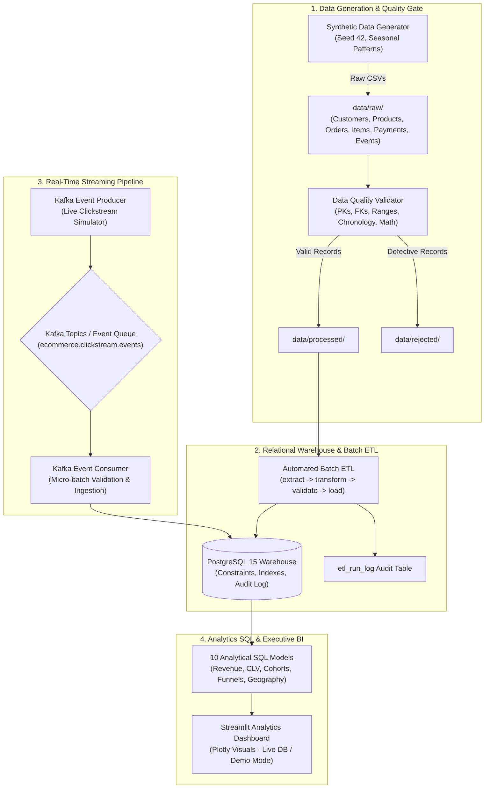

# Real-Time E-Commerce Data Engineering & Analytics Platform

[](https://www.python.org/)
[](https://www.postgresql.org/)
[](https://www.docker.com/)
[](https://streamlit.io/)
[]()
[]()

A portfolio-grade, production-style Data Engineering and Analytics platform simulating high-volume transactional and clickstream events, enforcing rigorous data quality gates, executing batch ETL with audit logging, running relational analytics in PostgreSQL, streaming real-time events via Kafka architecture, and visualizing business KPIs on an executive Streamlit dashboard.

---

## 1. System Architecture



---

## 2. Project Directory Structure

```text
realtime-ecommerce-data-platform/
│
├── data/
│   ├── raw/                 # Generated raw CSV datasets (10,500 orders)
│   ├── processed/           # Processed datasets & streamed events log
│   └── rejected/            # Isolated defective records
│
├── src/
│   ├── database/
│   │   ├── connection.py    # SQLAlchemy connection pool & retry logic
│   │   ├── schema_manager.py# DDL executor for tables & performance indexes
│   │   └── loader.py        # Schema-aligned bulk CSV / DataFrame loader
│   ├── etl/
│   │   ├── extract.py       # Robust CSV extraction with metadata logging
│   │   ├── transform.py     # String cleaning, type-casting, derived fields
│   │   ├── load.py          # Warehouse bulk loader wrapper
│   │   ├── pipeline.py      # End-to-end ELTV batch orchestrator & audit logger
│   │   ├── metrics.py       # Per-table row counts & runtime aggregations
│   │   └── report.py        # Automated Markdown execution report generator
│   ├── streaming/
│   │   ├── config.py        # Kafka broker settings & topic definitions
│   │   ├── producer.py      # Live clickstream event generator & Kafka producer
│   │   └── consumer.py      # Streaming micro-batch validator & DB consumer
│   ├── analytics.py         # SQL executor & offline demo data generator
│   ├── config.py            # Phase 1 generator configurations & paths
│   ├── data_generator.py    # Multi-entity synthetic e-commerce generator
│   ├── logger.py            # Centralized logging engine
│   └── validation.py        # 75-rule automated data quality & validation suite
│
├── dashboard/
│   └── app.py               # Streamlit + Plotly executive analytics dashboard
│
├── sql/
│   ├── schema.sql           # PostgreSQL DDL for 6 core entities + audit log
│   ├── indexes.sql          # B-tree performance indexes for analytical joins
│   └── analytics/           # 10 production SQL analytics models
│       ├── revenue_summary.sql
│       ├── monthly_revenue.sql
│       ├── top_products.sql
│       ├── category_performance.sql
│       ├── customer_lifetime_value.sql
│       ├── order_status_funnel.sql
│       ├── payment_analysis.sql
│       ├── event_funnel.sql
│       ├── repeat_customers.sql
│       └── revenue_by_state.sql
│
├── scripts/
│   ├── generate_data.py     # CLI data generator runner
│   ├── validate_data.py     # Standalone data quality validation runner
│   ├── create_schema.py     # DB schema and index migration runner
│   ├── load_data.py         # Direct raw CSV loader runner
│   ├── verify_database.py   # Row-count and connectivity verification
│   ├── simulate_stream.py   # Live streaming producer & consumer CLI
│   └── docker_entrypoint.py # Container startup orchestrator
│
├── tests/                   # 22 automated unit and integration tests
│   ├── test_data_generator.py
│   ├── test_validation.py
│   ├── test_etl.py
│   ├── test_streaming.py
│   └── test_analytics.py
│
├── docker-compose.yml       # Full-stack PostgreSQL + Streamlit app
├── docker-compose.kafka.yml # Enterprise Kafka + ZooKeeper + Kafka UI
├── Dockerfile               # Production multi-stage Python container
├── requirements.txt         # Pinned runtime dependencies
└── README.md
```

---

## 3. Quick Start & Execution Guide

### Option A: Run the Streamlit Dashboard (Immediate Demo Mode)
No Docker or PostgreSQL required — launches instantly with realistic mock data:
```powershell
streamlit run dashboard/app.py
```
Open **http://localhost:8501** in your browser. Toggle **"🔌 Use Live PostgreSQL"** in the sidebar whenever PostgreSQL is running.

---

### Option B: Run Real-Time Event Streaming Simulator
Simulate 50 live e-commerce clickstream events with micro-batch validation and throughput metrics:
```powershell
python scripts/simulate_stream.py --events 50 --rate 15 --batch 25
```

---

### Option C: Run Full-Stack with Docker Compose
Launches PostgreSQL and the Streamlit dashboard in containerized services:
```powershell
# 1. Start the entire platform
docker compose up -d

# 2. Open the dashboard
# Access http://localhost:8501

# 3. View running logs
docker compose logs -f
```

---

### Option D: Run Automated Batch ETL Pipeline (Local)
```powershell
# 1. Create warehouse schema and indexes
python scripts/create_schema.py

# 2. Run full ELTV batch pipeline with audit logging
python -m src.etl.pipeline

# 3. Verify database row counts
python scripts/verify_database.py
```

---

## 4. Running Automated Tests

Run the complete test suite (22 unit & integration tests):
```powershell
pytest -v
```

---

## 5. Key Engineering Highlights for Technical Interviews

1. **Defensive Schema Design & Idempotent Migrations**:
   - Primary keys (`CUST-...`, `ORD-...`, `PROD-...`), foreign key referential integrity with cascading constraints.
   - Non-negative `CHECK` constraints on financial figures (`price`, `cost`, `total_amount`, `payment_amount`).
   - Idempotent DDL scripts (`CREATE TABLE IF NOT EXISTS`, `CREATE INDEX IF NOT EXISTS`) and graceful schema inspection during batch inserts.

2. **Automated ELTV Pipeline with Audit Logging**:
   - `extract` captures file metadata, size, and extraction timestamps.
   - `transform` performs string normalization, timestamp parsing, and feature engineering (year/month cohorts, profit margins).
   - In-flight `validate` runs against relational rules and isolates rejected rows into `data/rejected/`.
   - Every run generates an audit entry in `etl_run_log` capturing status, processing duration, and row counts.

3. **Dual-Mode Streaming Ingestion**:
   - Kafka Event Producer and Consumer architecture capable of connecting to enterprise Kafka clusters (`PLAINTEXT://localhost:9092`) while gracefully falling back to standalone in-memory queues when running locally or during interview presentations.
